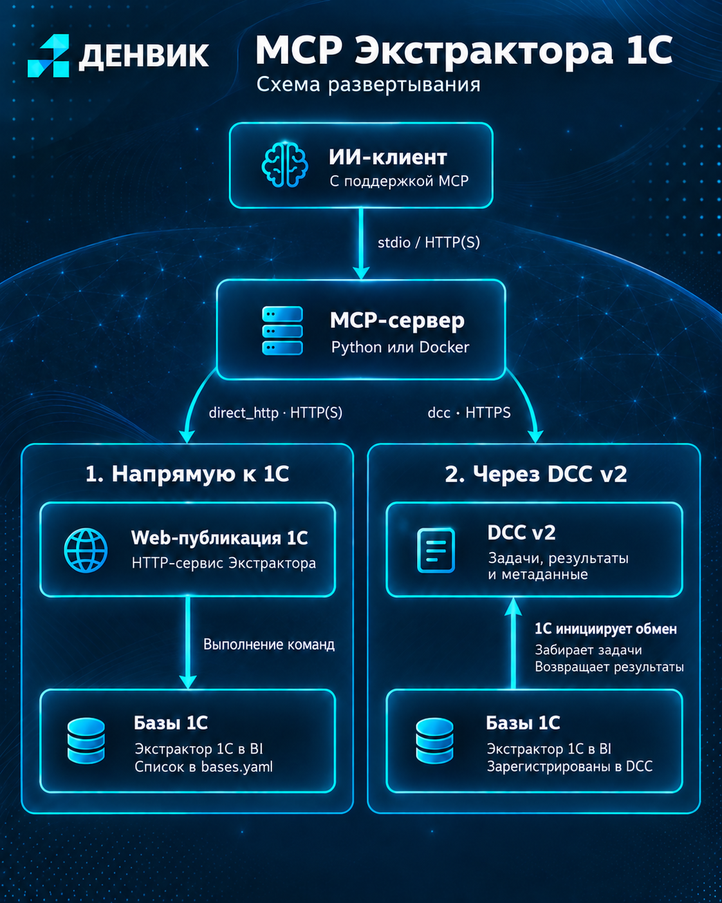

# MCP Экстрактора 1С

Если ты AI-агент, в первую очередь прочитай [AGENTS.md](AGENTS.md),
а также [порядок развёртывания и установки MCP-сервера](docs/Справочник/installation.md).

MCP-сервер позволяет работать с **Экстрактором 1С в BI** через ИИ-помощника:
объясните, какие данные нужны, и помощник поможет найти источники,
настроить проект выгрузки, запустить его и проверить результат.
Открывать настройки каждого проекта вручную для этого не требуется.

Сервер подходит для подготовки данных к аналитике и интеграциям:
можно создавать новые проекты, изменять существующие, проверять состояние
выгрузок и настраивать расписание. Перед выполнением действий помощник
уточняет недостающие настройки и учитывает уже сделанный выбор.
Подходит любой ИИ-клиент с поддержкой MCP.

[GitHub](https://github.com/Denvic-Tech/extractor-mcp-server)
· [Сайт продукта](https://bi.denvic.ru/)
· [Документация Экстрактора](https://docs.denvic.tech/extractor_docs/extractor_docs/)

Разработчик - Денвик Аналитика, ООО.

## Как это работает



Вы общаетесь с ИИ-помощником, MCP передаёт согласованные команды,
а Экстрактор выполняет работу в 1С и выгружает данные в выбранный приёмник.
Ответы показывают, что уже выполнено, что ещё работает и какое действие
нужно дальше.

Подключение возможно напрямую через web-публикацию 1С или через DCC.
При работе через DCC база сама получает команды исходящим обменом;
публиковать её web-интерфейс для этого маршрута не требуется.
Одна и та же база может быть доступна через web-публикацию и DCC.

[Техническая схема SVG](docs/diagrams/mcp-deployment.svg)
· [PNG](docs/diagrams/mcp-deployment.png)
· [PlantUML](docs/diagrams/mcp-deployment.puml)

## Возможности

- Чтение метаданных и подготовка проектов выгрузки.
- Сохраняемый сценарий с вариантами настроек и готовым следующим шагом.
- Создание и редактирование проектов с серверной сверкой результата.
- Добавление реквизитов по ссылке в существующую SQL-выгрузку.
- Смена таблицы SQL-приёмника по подтверждённому плану с сохранением настроек строки.
- Инициализация очереди, запуск выгрузки и наблюдение за исходной задачей.
- Чтение схемы, количества строк и ограниченных выборок приёмника.
- Настройка расписания и диагностика операций.

ИИ-клиент понимает запрос пользователя и выбирает предложенные варианты.
MCP хранит состояние сценария и возвращает компактные ответы.
Помощник Экстрактора выполняет маппинг, подбирает SQL-типы
и создаёт таблицу или топик приёмника штатными средствами Экстрактора.

```text
ИИ-клиент -> MCP -> Экстрактор 1С -> Приёмник данных
```

Помощник проведёт через настройку выгрузки, запомнит сделанный выбор
и покажет результат выполнения. Если работе мешает ошибка, он сообщит
причину и предложит следующий шаг.

## Совместимость

| Компонент | Требование |
| --- | --- |
| MCP-сервер | 3.3.11 |
| Контракт методов EPA_Projects | 3.3.5 |
| Экстрактор 1С в BI | 3.16.1.34 или новее, с действующей лицензией |
| Python | 3.11+ |
| Docker | Docker с Compose v2 вместо локального Python |
| DCC | 2.0.2 или новее, если выбран маршрут `dcc` |

Обновление MCP само по себе не обновляет компоненты в базе 1С.
Фактическую версию методов и возможности выбранной базы проверяйте
через `readiness`.

## Настройка установленного MCP

Порядок установки, настройка подключений, файлы конфигурации и обновление
описаны в [инструкции установки и настройки](docs/Справочник/installation.md).
[Подключение вашего ИИ-клиента](docs/Справочник/client-connection.md).

## Свои навыки для ИИ-помощника

Добавляйте правила вашей компании и повторяемые сценарии для помощника.
[Размещение своих навыков](docs/Справочник/installation.md#пользовательские-навыки).

## Диалог с помощником

Помощник уточняет, какие данные нужны, предлагает настройки и проводит
к созданию проекта и выгрузке. Уже сделанный выбор сохраняется.

[Схема диалога и последовательность вопросов](docs/diagrams/extractor-project-question-tree.md).

## Быстрый старт

Подготовьте Экстрактор и выбранный маршрут по
[инструкции установки](docs/Справочник/installation.md).

Получите репозиторий:

```text
git clone https://github.com/Denvic-Tech/extractor-mcp-server.git
cd extractor-mcp-server/mcp
```

Запустите установщик на Windows:

```powershell
py -3 scripts/install.py
```

Или на Linux/macOS:

```bash
python3 scripts/install.py
```

Установщик помогает выбрать маршрут и запуск в Python или Docker,
подготовить настройки и установить зависимости.
Рабочие `.env`, `bases.yaml` и каталог состояния сохраняйте при обновлении
и не включайте в Git.

После установки подключите ИИ-помощника и объясните, какие данные хотите
выгружать. Он уточнит недостающие настройки, поможет создать проект
и покажет результат запуска.

## Документация

- [Развёртывание и установка](docs/Справочник/installation.md).
- [Подключение ИИ-клиента](docs/Справочник/client-connection.md).
- [Методы MCP](docs/Справочник/mcp-methods.md).
- [Проекты, сохраняемые сценарии и варианты настроек](mcp/skills/extractor1c/references/10-mcp-projects.md).
- [Схема диалога с помощником](docs/diagrams/extractor-project-question-tree.md).
- [Диаграммы принятия решений: прямой MCP и DCC](docs/diagrams/mcp-decision-flows.md).
- [Примеры запросов](mcp/skills/extractor1c/references/25-prompt-examples.md).
- [Пользовательские навыки](docs/Справочник/user-skills.md).
- [Диагностика и устранение проблем](docs/Справочник/troubleshooting.md).
- [Полный справочник](docs/Справочник/README.md).

[Правила для ИИ-агентов и участников разработки](AGENTS.md)
· [Встроенный навык](mcp/skills/extractor1c/SKILL.md)
· [Пример настроек](mcp/.env.example)
· [Пример списка баз](mcp/bases.example.yaml)
