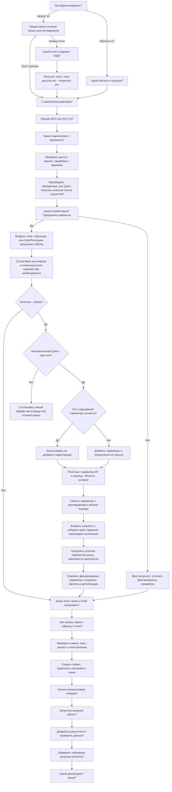

# Дерево вопросов для настройки выгрузки 1С

Дерево относится к созданию новой выгрузки. Начинай с первого неизвестного
ответа. Явно названные способ, объекты, запрос, база, подключение, сегменты
и разрешенные действия уже являются ответами. Существующий проект запускай
по сохраненным настройкам, без опроса о создании.

Технические узлы и наличие параметров определяй сам по инструментам и тексту.
Пользователю задавай только вопросы с неизвестным выбором или смыслом.
Параметризацию готового запроса выполняй сам после согласования сегментов.



```text
Способ выгрузки?
+-- Объекты: какие объекты и данные?
+-- Запрос: получить текст; для отчета уточнить вариант СКД
    +-- Нет доступа к СКД: попросить текст
Обе ветви: база -> маршрут -> подключение -> проверка доступа и приемника
  -> Метаданные; для Query штатный список всех сущностей запроса
  -> Сегментация?
     +-- Нет: весь результат, фиксированные параметры
     +-- Да: поле и функция; для СрезПоследних предложить Месяц
         -> Регулярная и начальная роли; extended при необходимости
         +-- Объект: перейти к полям
         +-- Запрос: одна ось для автоматического построения?
             +-- Нет: явный обработчик очереди или готовый проект
             +-- Да: есть подходящие параметры сегмента?
                 +-- Да: использовать их, добавить недостающие
                 +-- Нет: добавить параметры и ограничения по смыслу
                 -> Регистры: параметры ВТ и границы; объекты: условия
                 -> Связь параметров с группировками и ролями очереди
                 -> Сущность с отбором через параметр: подтвердить включение
                 -> Затем штатный обработчик Query; зависимости выключены
                 -> Фиксированные параметры отдельно; расчеты/детализация сохранены
Обе ветви: поля/связи/GUID -> имена -> проверка запроса/типов/сопоставления
  -> Создание и перечитывание настроек и схемы
  -> Инициализация? -> Запуск? -> Ожидание и проверка данных?
  -> Проверка повторной выгрузки? -> Расписание?
```

Ветки после создания - отдельные решения. При ответе «нет» пропускай действие.
Без запуска не нужен вопрос об ожидании, без сегментов может не требоваться
инициализация. Повторную выгрузку выполняй по заданию пользователя или в рамках
уже разрешенной проверки. При ошибке доступа или схемы останови зависимую запись,
сохрани ответы и объясни конкретную причину.

Для SQL при `direct_sql_operations` используй прямые операции. Для Kafka, AMQP
и 1С Шины сохраняй предварительный просмотр и `planId`. Исследование и добавление
параметров выполняет агент до передачи `queryText`; сервер сохраняет подготовленный
текст. Каждый сегмент берется из очереди и запускает тот же запрос со своими
значениями параметров. Пустая строка - допустимый подстрочный сегмент, а не весь
результат. Нормализуй регистр ключей и проверь поддержку условия целевой платформой.

Для Query сначала получи штатный список всех сущностей запроса. Определи,
набор данных какой сущности ограничивается отбором через параметр, согласуй
ее включение как `object` и только затем настрой обработчик. Зависимости для
обогащения сохрани выключенными. Сторона `JOIN` сама по себе не критерий.
Фиксированный параметр в `ГДЕ` может управлять отбором; его роль сегмента очереди
задается отдельно. Расчетный параметр в `ВЫБОР` или проекции не является отбором.
Не создавай отдельные входные поля для дополнительных источников или override
инициализатора. Сохраняй согласованный выбор при обновлении проекта.

При автоматическом создании Query используется одна ось с независимыми
`regular`, `extended`, `initialization`. Для нескольких групп построитель вернет
`QUERY_NATIVE_SINGLE_AXIS_REQUIRED`: согласуй явно настроенный обработчик очереди
или готовый проект. Ограничение не распространяется на ветвь объектов и чтение,
запуск, field_mapping существующих вручную настроенных Query. Полный Query без
сегментов передается с `segmentation: []`, без `object` и назначения обработчика.
