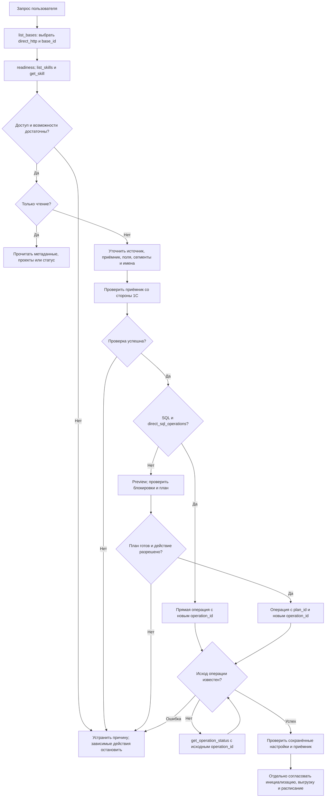
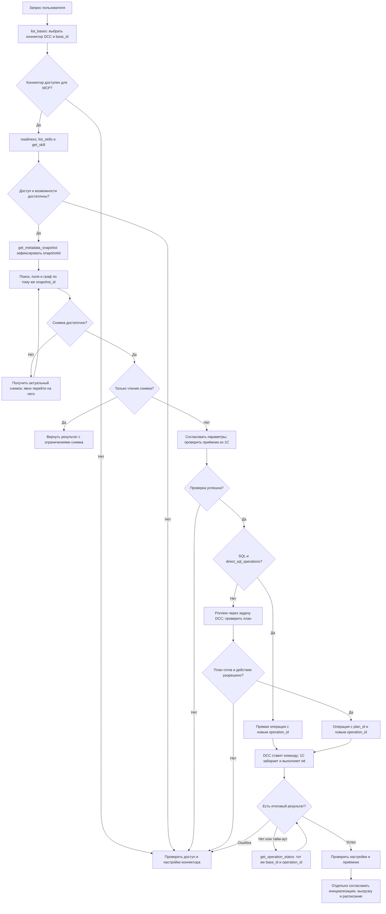

# Принятие решений при работе через MCP

MCP — интерфейс для ИИ-помощника. До 1С команды доходят напрямую через
HTTP либо через DCC, откуда 1С забирает их исходящим обменом.
Выбранный `base_id` сохраняется во всех вызовах операции.

## Прямой маршрут MCP → 1С



```text
Запрос → list_bases: direct_http, base_id
       → readiness; list_skills; get_skill
       → Доступ и возможности достаточны?
         Нет → Устранить причину; зависимые действия остановить
         Да  → Только чтение?
               Да  → Прочитать метаданные, проекты или статус
               Нет → Уточнить источник, приёмник, поля, сегменты, имена
                   → Проверить приёмник со стороны 1С
                   → Проверка успешна?
                     Нет → Остановить зависимые действия
                     Да  → SQL и direct_sql_operations?
                           Да → Прямая операция с новым operation_id
                           Нет → Preview; блокировки и план
                               → План готов и действие разрешено?
                                 Нет → Остановить зависимые действия
                                 Да → Операция: plan_id, новый operation_id
                   → Исход операции известен?
                     Нет → get_operation_status с исходным ID
                         → Повторно оценить исход
                     Ошибка → Остановить зависимые действия
                     Успех → Проверить настройки и приёмник
                           → Отдельно согласовать инициализацию,
                             выгрузку и расписание
```

## Маршрут MCP → DCC → 1С



```text
Запрос → list_bases: коннектор DCC, base_id
       → Коннектор доступен для MCP?
         Нет → Проверить доступ и настройки коннектора
         Да  → readiness; list_skills; get_skill
             → Доступ и возможности достаточны?
               Нет → Проверить доступ и настройки
               Да → get_metadata_snapshot: snapshotId
                  → Поиск, поля и граф с тем же snapshot_id
                  → Снимка достаточно?
                    Нет → Получить актуальный снимок; явно перейти на него
                        → Повторить чтение
                    Да → Только чтение снимка?
                         Да → Результат с ограничениями снимка
                         Нет → Согласовать параметры; проверить приёмник
                             → Проверка успешна?
                               Нет → Проверить доступ и настройки
                               Да → SQL и direct_sql_operations?
                                    Да → Операция с новым operation_id
                                    Нет → Preview через DCC; проверить план
                                        → План готов, действие разрешено?
                                          Нет → Проверить причину
                                          Да → plan_id, новый operation_id
                  → DCC ставит команду; 1С забирает и выполняет её
                  → Есть итоговый результат?
                    Нет / тайм-аут → get_operation_status с теми же ID
                                   → Повторно оценить результат
                    Ошибка → Проверить причину
                    Успех → Проверить настройки и приёмник
                          → Отдельно согласовать инициализацию,
                            выгрузку и расписание
```

## Общие правила

- Если база доступна обоими способами, маршрут выбирает пользователь.
  Автоматического переключения нет.
- Уже согласованные параметры и разрешённые действия повторно не спрашивают.
- Неопределённую запись нельзя повторять с новым `operation_id`.
  Состояния `queued` и `running` не являются итоговыми.
- Завершение операции запуска не подтверждает выгрузку. Результат проверяют
  через `get_project_export_status` с возвращённым `task_id`;
  успешная выгрузка имеет статус `succeeded`.
- Для Kafka, AMQP и 1С Шины план preview обязателен. Для SQL при
  `direct_sql_operations` preview можно использовать для диагностики.
- Расписание: чтение → preview → подтверждение пользователя → запись →
  повторное чтение. Перед подтверждением показывают часовой контекст,
  пользователя выполнения и момент активации. Включение может запустить выгрузку.

См. также [схему диалога и последовательность вопросов](extractor-project-question-tree.md)
и [справочник методов MCP](../Справочник/mcp-methods.md).
